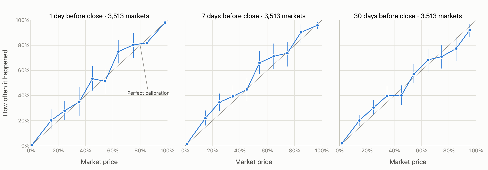
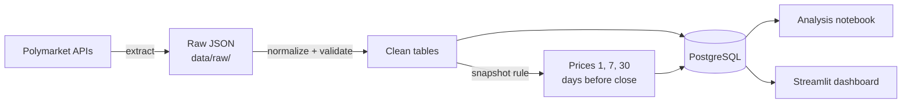

# Are Prediction Markets Calibrated?

**[▶ Explore the live dashboard](https://polymarket-calibration.streamlit.app)**: filter the markets and see the results for yourself. The data updates automatically every day as new markets resolve. *If the app has gone to sleep after a quiet spell, click "Yes, get this app back up!" and give it about 30 seconds.*

[](https://github.com/karakusethem09/prediction-markets/actions/workflows/pipeline.yml) [](https://github.com/karakusethem09/prediction-markets/actions/workflows/tests.yml)

Every day, people around the world try to predict the future: who will win an election, whether the central bank will cut rates, which team will win on Sunday. On a prediction market they back those predictions with money by buying and selling contracts that pay $1 if the event happens. The market price reflects the prices at which participants are willing to buy and sell those contracts, so it works as the crowd's combined estimate of the probability. A "Yes" share trading at 70 cents means the market thinks there is a 70% chance it will happen.

A single market is just one guess, and one guess can't be right or wrong about a probability. If something priced at 70% doesn't happen, the market wasn't necessarily wrong, because 30% outcomes happen all the time. So I got curious about a bigger question: **what happens when you add thousands of these markets together?** Of all the things the crowd priced at 70%, did about 70% actually happen? Of everything priced at 10%, did about one in ten come true?

If the answer is yes at every price level, the market is **calibrated**: its prices can be read as honest probabilities. This project measures that for [Polymarket](https://polymarket.com), using more than 10,000 resolved markets that each traded at least $1 million.



*Each dot groups markets with similar prices. On the gray diagonal, prices match reality exactly. Vertical bars are 95% intervals from resampling whole events, because related markets move together. Chart: the 3,513 markets that had a price at all three horizons as of October 20, 2026.*

## What I found

*These numbers come from the data as of October 20, 2026 (10,768 markets with snapshots). The live dashboard always shows the latest numbers, which shift slightly as new markets resolve.*

1. **The crowd is well calibrated.** On average, prices were only **1.2, 1.9 and 2.0 percentage points** away from what actually happened, 1, 7 and 30 days before the market closed (on the 3,513 markets with all three; 95% intervals [0.9, 2.1], [1.5, 3.0] and [1.4, 3.2]).
2. **Prices get sharper as the deadline approaches.** On the same markets, the Brier score (lower is better) falls from **0.089** at 30 days to **0.067** at 7 days to **0.046** at 1 day.
3. **Overall, prices are a little too extreme.** The *calibration slope*, fitted on prices between 5% and 95%, is **0.74** [0.68, 0.79] one day before close, **0.72** [0.66, 0.80] at 7 days and **0.82** [0.71, 0.93] at 30 days. A slope of 1 would mean honest prices; below 1 means things happen closer to 50% than priced. For example, outcomes priced 10–20% one day before close happened **25.1%** of the time against an average price of **14.9%** (534 markets). This is the opposite of the well-known *favorite–longshot bias*, where long shots are usually overpriced.
4. **Close to the end, the bias comes mostly from shorter markets.** On long-running markets it is clear only 30 days out (0.82 [0.70, 0.93]); at 1 and 7 days the intervals include 1. That points at markets open only days or weeks, like sports games: the next thing to test.
5. **The intervals account for related markets.** Markets in one event (e.g. candidates in an election) share an outcome, so all intervals come from an [event-level bootstrap](src/analysis/bootstrap.py) that resamples whole events. It widens them only slightly, and no conclusion changes.

The full analysis, with the robustness checks and caveats, is in [`notebooks/calibration.ipynb`](notebooks/calibration.ipynb).

## Research: is there a trade in long shots?

The calibration results raise an obvious investor's question: if contracts priced at 20–30 cents win more often than 20–30% of the time, would buying them have made money? I treated this as a research study, not a trading system, and tested it the way a sceptical analyst would: start with the attractive number, then try to break it.

### The trade being tested

Buy one **YES contract** when it trades between **20 and 30 cents** (*Group A*), hold it until the market settles, and collect **$1** if the event happens or **$0** if it doesn't. At an average price of 25 cents, the position breaks even if it wins **25%** of the time; any win rate above that is profit. A second price band, **50–60 cents** (*Group B*), was tested alongside it.

### Step by step

1. **The starting evidence.** The calibration chart showed that, a week before the market closed, contracts in both price bands settled YES more often than their prices implied.
2. **First test: the 100 most recent trades.** Group A returned **84%** on the capital invested (28 trades) and Group B **13%** (72 trades). Numbers this good from so few trades usually mean luck, so the next step was more data.
3. **Full history: 992 trades since 2024.** Group A fell to **48%** (372 trades). Group B fell to **2%**, with a range that includes zero: no reliable edge. From here on the research focused on Group A.
4. **Found and removed a hidden bias.** The entry was timed "7 days before the market *closed*". But many markets close early *because* the event happened, which a trader cannot know in advance. That is a **look-ahead bias**, and it showed: markets that ended early carried a **+19-point** edge, markets that ended on schedule only **+3**. I re-timed every entry to **7 days before the scheduled end date**, which is known in advance, and only counted markets still trading at that moment. Group A: **33%** (390 trades). Group B: **−3%**.
5. **Stress tests for Group A, with the rules written down before looking at the results.** Every check was run separately on an **earlier period** (before July 2026) and a **later period** kept aside for confirmation:
   - **Not just sports:** single games and matches returned **29%**, all other markets (politics, crypto, economics) **45%**.
   - **Liquidity:** stronger in thinner markets (**41%**) than in busier ones (**25%**, with a range that includes zero). This is a warning sign, because thin markets usually cost more to trade.
   - **Entry timing:** in the earlier period the return was about **24–26%** whether the contract was bought 3, 7 or 14 days before the scheduled end. A real effect shouldn't depend on one exact day.
6. **Measured the uncertainty honestly.** Several markets can hinge on the same event, so the uncertainty was estimated by resampling whole events, not individual trades. Group A's 95% range is **15% to 52%**: wide, but above zero.

### From inputs to result

| Step | Count |
|---|---|
| Resolved markets with at least $1M traded, downloaded from Polymarket | 11,438 |
| Kept after cleaning (clear final result, open at least a day) | 10,839, backed by 3.1 million price observations |
| With a usable price 7 days before the *scheduled* end, still trading at that moment | 5,952 |
| Priced 20–30 cents at that moment (Group A) | **390 trades** from 356 separate events, settling July 2024 – October 2026 |
| …of which in the earlier period / the later check period | 320 / 70 |

### Result (Group A, one contract per trade)

| | |
|---|---|
| Trades | 390 (130 won, 260 lost) |
| Win rate vs break-even win rate | **33.3%** vs 25.0% |
| Capital invested / profit | $97.54 / **$32.46** |
| Return on capital | **33.3%** (95% range: 15% to 52%) |
| After an assumed 2 cents per contract in trading costs | **23.4%** |

### What this means, and what it doesn't

- **A consistent historical pattern:** long shots priced at 20–30 cents settled YES more often than their price implied. It held across market types, entry days and both time periods.
- **Not a proven strategy.** The returns use recorded prices, not prices you could actually have bought at. A real buyer pays the asking price, which can be several cents higher, especially in the thin markets where the pattern was strongest. The 20–30 cent band was also chosen after looking at this history, and Polymarket can change a market's scheduled end date while it trades.
- **The next step before risking money:** historical **order-book data** (bid and ask prices, and how many contracts were available) for Group A trades in busier markets, to see whether the edge survives realistic buying costs.

The full studies, with every table, are in [`docs/combined_yes_strategy.md`](docs/combined_yes_strategy.md) and [`docs/group_a_deep_dive.md`](docs/group_a_deep_dive.md).

## How it works



| Step | Code | What it does |
|---|---|---|
| Extract | [`src/extract/polymarket.py`](src/extract/polymarket.py) | Downloads resolved markets (cursor pagination) and each market's daily and hourly price history. Every raw response is saved before anything else touches it. Retries with exponential backoff. |
| Transform | [`src/transform/normalize.py`](src/transform/normalize.py) | Builds clean `markets` and `price_history` tables. Keeps only markets with a clear final result that were open at least a day. Validated with [pandera](https://pandera.readthedocs.io). |
| Snapshots | [`src/transform/snapshots.py`](src/transform/snapshots.py) | Takes each market's price 1, 7 and 30 days before it closed: the latest price *at or before* that moment, never after, so the result can't leak in. |
| Load | [`src/load/postgres.py`](src/load/postgres.py) | Upserts everything into PostgreSQL in one transaction (rerunning never duplicates rows) and logs each run. |
| Analyze | [`src/analysis/calibration.py`](src/analysis/calibration.py) | Price buckets, Wilson confidence intervals, Brier score, Brier skill score and calibration error. |
| Show | [`app/dashboard.py`](app/dashboard.py) | Interactive Streamlit dashboard with filters for volume, years and platform, and when the data was last updated. |

### Daily updates in production

The [live dashboard](https://polymarket-calibration.streamlit.app) reads from a hosted PostgreSQL database ([Supabase](https://supabase.com)) that a [GitHub Actions workflow](.github/workflows/pipeline.yml) keeps up to date:

1. **Every day**, the workflow first runs all the tests against a throwaway PostgreSQL database. If any test fails, nothing is updated.
2. It then runs [`src/pipeline.py`](src/pipeline.py), which is **incremental**: it downloads the market list, but fetches price history only for markets that resolved since the last run, typically a few dozen instead of 11,000, plus markets still waiting for their prices (see below).
3. Before writing anything, **[data quality checks](src/transform/quality.py)** must pass: the download isn't suspiciously small, both tables match their schemas (including "no price from after the snapshot time"), and no snapshot lacks its market. If one of these fails, nothing is loaded. A separate coverage check records what share of possible snapshots was found, without blocking the update.
4. Every run, successful or not, is logged in a `pipeline_runs` table with row counts, check results and any error.
5. The dashboard always shows the data's freshness: **LIVE** if the last successful update is under 36 hours old, **STALE** if not (the daily job has probably stopped), and **UPDATE FAILED** if the latest run failed, each with an explanation and the recent update history. So it can never say LIVE while showing days-old data.

The dashboard connects with a read-only database login, and the hosted database blocks access through Supabase's public web API ([`sql/supabase_security.sql`](sql/supabase_security.sql)). `python src/load/secure_online_database.py --verify` checks that every table is still locked down.

### Recovering from missing data

Right after a market resolves, its price history is sometimes not available yet. An early version of the pipeline saved such a market anyway, and since it was then "already in the database", it never looked at it again, so its snapshots would never arrive. The pipeline now tracks every market in a `processing_status` table ([`src/transform/completeness.py`](src/transform/completeness.py)):

| Status | Meaning | What the pipeline does |
|---|---|---|
| `complete` | Every *possible* snapshot exists | Nothing |
| `retry_needed` | No price history came back yet | Downloads its prices again on the next daily runs |
| `unavailable` | Retrying can't help, with a `reason`: the prices don't cover that moment (trading started after the listed open time, or a multi-day gap), or there are still no prices after 7 attempts or 14 days | Stops retrying; this is the list to investigate |

Two design decisions matter here:

- **"Possible" depends on how long the market was open.** A market open for 3 days can never have a 7- or 30-day snapshot, so it is `complete` with just its 1-day one. A horizon counts only if `close_time − horizon ≥ open_time`, the same rule the snapshot step uses.
- **Only retry when a retry can help.** On the real data, the first version of this rule kept retrying markets whose prices *had* arrived but started a few hours after the listed open time. Those now go straight to `unavailable` with that reason, instead of being downloaded again for a week.

### Design choices worth knowing

- **Never the final price.** A resolved market's last price is already 0 or 1, because by then everyone knows the answer. The analysis only uses prices from 1, 7 and 30 days before close.
- **The real close time, not the deadline.** Many markets resolve before their deadline (a question like "…by the end of 2027?" can be settled long before then), so horizons are measured from when the market actually closed.
- **Fair comparisons between horizons.** The 1-day group naturally contains thousands of short markets, like sports games, that weren't open 30 days earlier. Horizons are therefore compared on the same set of markets.
- **Short markets are excluded.** Markets open for less than a day are easier to move with a single large trade, and they have no meaningful 1-day horizon.
- **Uncertainty that respects related markets.** Standard confidence intervals assume every market is independent, but markets in one event share an outcome. The [event-level bootstrap](src/analysis/bootstrap.py) resamples whole events instead. The calibration slope is fitted only on prices between 5% and 95%, because in testing, how near-certain prices were squashed at the edge of the scale moved the slope from 0.97 to 1.21.

## Tech stack

Python 3.13 · requests · pandas · pandera · PostgreSQL 16 (Docker Compose) · psycopg · SQLAlchemy · Plotly · Streamlit · pytest

## Getting started

You need Python 3.13 and [Docker Desktop](https://www.docker.com/products/docker-desktop/).

```bash
git clone https://github.com/karakusethem09/prediction-markets.git
cd prediction-markets

python3.13 -m venv .venv
source .venv/bin/activate
pip install -r requirements.txt
pip install -e .                      # makes the packages in src/ importable

docker compose up -d                  # start PostgreSQL

python src/extract/polymarket.py      # download markets + price histories (several hours the first time; safe to stop and resume)
python src/load/postgres.py           # normalize, take snapshots, load into PostgreSQL (~30 s)
python src/pipeline.py --with-prices  # later: add only markets resolved since the last run (~1 min)

streamlit run app/dashboard.py        # open the dashboard at http://localhost:8501
```

To explore the analysis, open `notebooks/calibration.ipynb` in VS Code or Jupyter with the `.venv` kernel.

## Tests

```bash
pytest
```

98 tests cover the API retry logic, pagination, normalization, the snapshot rule (including a check that it never uses a future price), the data quality checks, snapshot completeness and retries, the incremental pipeline, the database upserts, the calibration math, the event-level bootstrap (checked against simulated data with a known answer), the freshness rule and the dashboard itself. All HTTP calls are mocked. Database tests run in a throwaway schema of `TEST_DATABASE_URL` (the local Docker database by default), never the live database. The dashboard tests run the real Streamlit app against a small synthetic dataset, so they check exact numbers and need no real data.

[GitHub Actions](.github/workflows/tests.yml) runs every test on each push and pull request, and again before every daily update. There, a missing database makes the run fail instead of skipping the database tests, so a green badge means every test actually ran.

## Project structure

```
src/extract/      API clients: raw downloads only
src/transform/    normalize.py, snapshots.py, schemas.py (pandera)
src/load/         postgres.py: upserts and pipeline_runs logging
src/analysis/     calibration.py: the calibration math and chart
sql/schema.sql    tables: markets, price_history, snapshots, pipeline_runs
notebooks/        the analysis write-up
app/              Streamlit dashboard
tests/            pytest
data/raw/         cached API responses (git-ignored)
```

## Limitations

- Only markets with at least $1M volume, ending from July 2020 onward. Markets that closed before 2023 have no price history in Polymarket's API.
- Markets within the same event (for example many candidates in one election) are related, so the true uncertainty is somewhat wider than the confidence bars show.
- "Happened" refers to the first listed outcome of each market (for example "Yes").
- Prices are not trades: a real trader would also pay the bid–ask spread and fees.
- Polymarket leaves most markets without a category, so the results can't yet be split by topic, such as sports vs politics.

## What's next

- Split the results by topic (e.g. sports vs politics), to test whether the bias in findings 3 and 4 comes from short sports markets.
- Add [Kalshi](https://kalshi.com) as a second platform. The pipeline is built so that only the extract and normalize steps are platform-specific.
